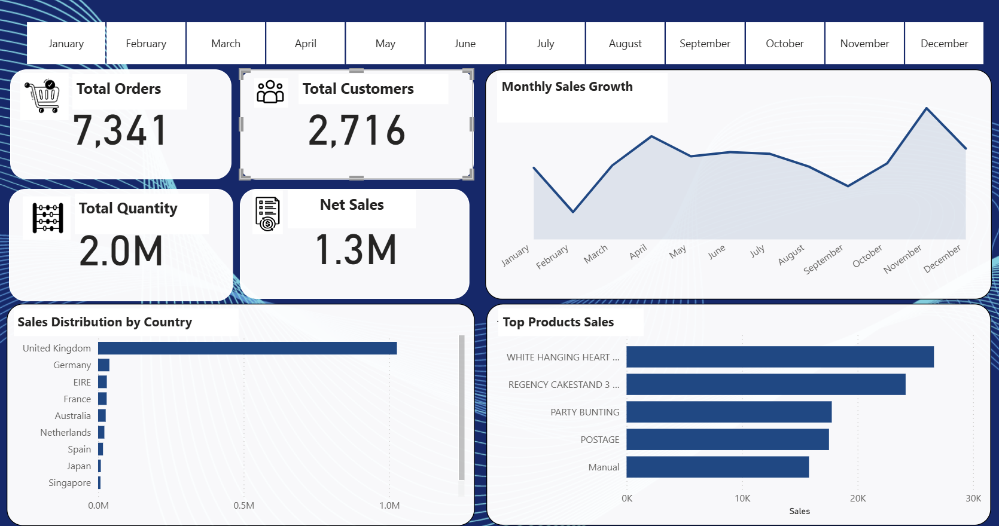

# Customer & Revenue Analytics

**SQL Server · Power BI · Excel · Power Query**

An analytical portfolio project exploring revenue performance, repeat purchasing, and customer concentration across retail transaction data.

[SQL analysis](sql/) · [Sample data](data/) · [Dashboard details](powerbi/)

## Business questions

- How does revenue change from month to month?
- Which customers, countries, and products contribute the most revenue?
- How many customers place more than one order during the observed period?
- How concentrated is revenue among the highest-spending customers?

## Results from the original analysis

| Metric | Reported result |
| --- | ---: |
| Sales records analyzed | 146K+ |
| Orders | 7,341 |
| Customers | 2,716 |
| Total revenue | 3.36M |
| Repeat customer rate | 52% |
| Top 10 customers' share of revenue | 17.3% |

These figures describe the original analysis. The CSV files published here are demonstration samples, so running the queries on them will produce sample-level results. Revenue is shown without a currency symbol because the published assets do not establish the currency.

## Metric definitions

- **Orders:** distinct invoice IDs. A transaction line is not a separate order.
- **Repeat customer rate:** customers with more than one distinct invoice divided by customers with at least one invoice in the observation period. This is a repeat-purchase measure, not a cohort-based retention or churn rate.
- **Customer revenue:** revenue accumulated within the available data. The legacy CLV script measures observed customer revenue; it does not forecast future lifetime value.
- **Revenue concentration:** the top 10 customers' revenue divided by total revenue, using the same data scope and filters.

The dashboard preview shows the sales overview. Repeat purchasing is covered by the SQL analysis; the published screenshot does not display the repeat-customer KPI.

## Analysis workflow

1. Review sample fields, missing values, transaction validity, and date types.
2. Load the cleaned sample into SQL Server as `retail_sales`.
3. Run the SQL files to examine monthly sales, repeat customers, customer value, and concentration.
4. Review the Power BI screenshot alongside the documented metric definitions.
5. Interpret the outputs within the data's observation period and sample coverage.

## Repository guide

| Path | Contents |
| --- | --- |
| [data/](data/) | Original and cleaned CSV samples, with usage notes |
| [sql/](sql/) | Eight SQL analysis scripts and a query guide |
| [powerbi/](powerbi/) | Static dashboard preview and publication notes |

## Run the SQL examples

Use SQL Server with a client such as SQL Server Management Studio. Import `data/online_retail_cleaned_sample.csv` into a table named `retail_sales`. Match the column names used in the queries, including `Customer_ID`, `Invoice_ID`, `Invoice_Date`, `Revenue`, and `Country`. Set dates and numeric columns to appropriate SQL types before execution.

Run each script in [sql/](sql/) separately. Compare counts and totals before interpreting the results; the repository does not include an automated database setup or the full source dataset.

## Business interpretation

The reported revenue concentration suggests that high-value customer relationships warrant monitoring. Repeat purchasing can help identify customer groups for further investigation. These findings support analysis and prioritization; no revenue uplift or causal business impact is claimed.

## Published scope

The repository includes SQL, sample data, and a static Power BI screenshot. The original PBIX file, exported DAX/model definitions, and complete cleaning implementation are not currently included. An interactive report is not linked. The samples demonstrate the query structure and are not a substitute for the complete dataset.

## Author

**Maged Bin Laswad** · [LinkedIn](https://www.linkedin.com/in/maged-binlaswad-63261726a/)
