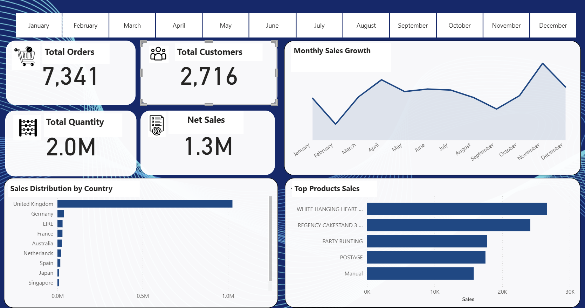

# Power BI dashboard preview

## What the preview shows

- Total orders, customers, quantity, and revenue.
- A monthly sales trend and month filters.
- Sales by country and top products.

This is a static screenshot of the original Power BI report. Filters are not interactive on GitHub. The screenshot does not display the repeat-customer KPI discussed in the main project; see the [SQL analysis](../sql/) for the repeat-purchase logic.

## Available files

| File | Purpose |
| --- | --- |
| [customer-retention-dashboard.png](customer-retention-dashboard.png) | Dashboard screenshot |
| README.md | Preview and publication notes |

The original `.pbix` file, DAX measures, and model definition are not published in this repository. The preview cannot be refreshed or independently inspected as a Power BI model. The main [README](../README.md) documents the analysis scope and metric definitions.

## Interpretation

Revenue uses the source data's units; confirm the currency before quoting monetary results. A monthly sales trend and month-over-month percentage growth are different measures and should be labeled with their units when the report is next updated.

[Back to project](../README.md) · [Maged Bin Laswad on LinkedIn](https://www.linkedin.com/in/maged-binlaswad-63261726a/)
